  

<a href="https://lotoz.github.io/Lotoz-Web/">Visit my website</a>

## About Me

I'm Zamira Grippi, also known as Lotoz. I'm focused on cybersecurity, especially Blue Team practices, and enjoy exploring Linux and building useful tools. I'm always learning, experimenting, and sharing what I make.

### Focus Areas

- System hardening
- Digital forensics
- Ethical hacking
- Security auditing
- Linux systems

## Technologies & Tools

**Security tools:** CAINE · Metasploit · Nmap · Wireshark · Burp Suite · OWASP ZAP

## Selected Projects

- [PenguiAntivirus](https://github.com/Lotoz/PenguiAntivirus) — A security auditing tool for Linux systems.
- [Diplomacy for Dukes](https://github.com/Lotoz/Diplomacy-API-RestFull-Springboot) — A REST API for the Diplomacy game.
- [Pomodoro War](https://github.com/Lotoz/The-Adventure-of-the-Pomodoro) — A gamified task manager and Pomodoro timer where focused work powers a fantasy army.

## Education & Learning

- **Cybersecurity**, Alan Turing — currently studying.
- **C programming** — self-study, focusing on the fundamentals.

## Connect

<!-- Contribution graph -->
<picture>
  <source media="(prefers-color-scheme: dark)" srcset="https://raw.githubusercontent.com/lotoz/lotoz/output/pacman-contribution-graph-dark.svg">
  <source media="(prefers-color-scheme: light)" srcset="https://raw.githubusercontent.com/lotoz/lotoz/output/pacman-contribution-graph.svg">
  
</picture>

###

#### A little question: how many penguins can you spot in this README?

  - 
  - 
  - 
  - 

🐧 Choose wisely! 🐧
